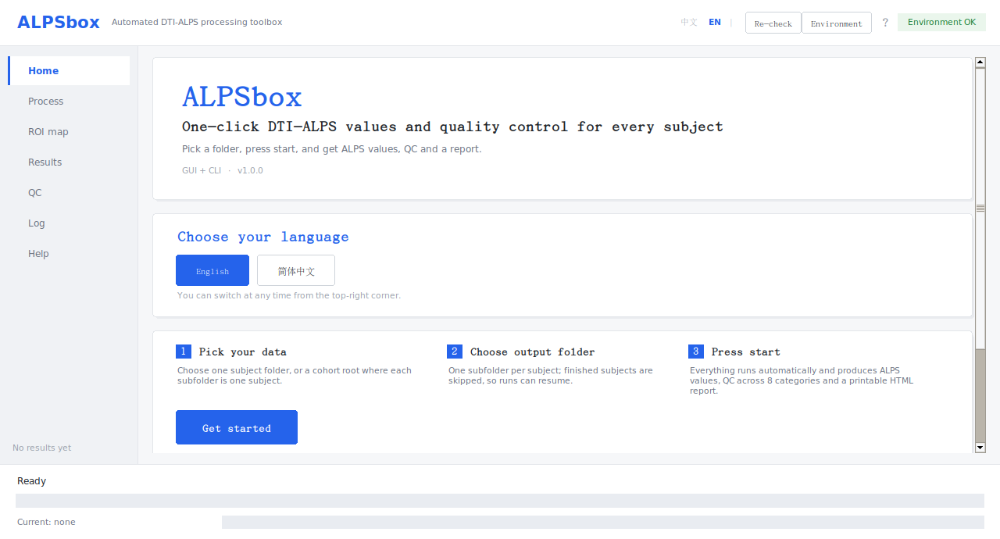
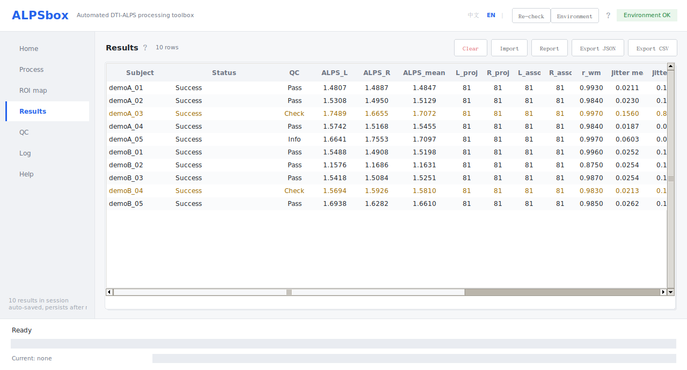
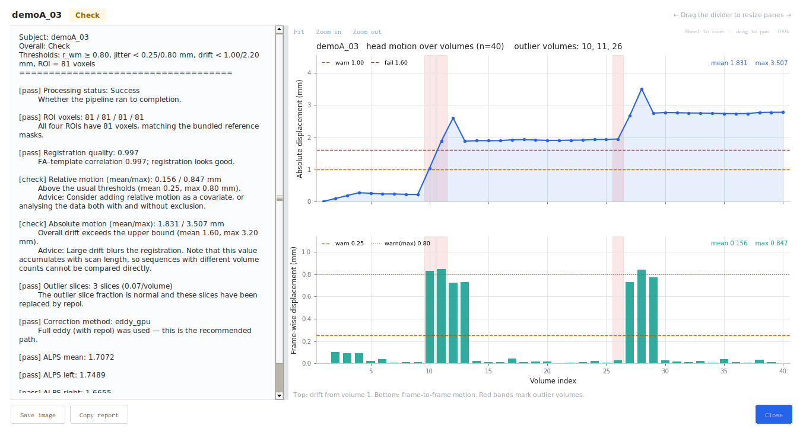

# ALPSbox

**One-click DTI-ALPS values and quality control for every subject.**

[**English**](README.md) | [**简体中文**](README.zh-CN.md)

[](https://doi.org/10.5281/zenodo.24137518)

ALPSbox computes the diffusion tensor image analysis along the perivascular
space (DTI-ALPS) index from diffusion MRI, per subject or for a whole cohort,
and adds the parts that a study actually needs: input validation, resumable
batch processing, quality control across eight categories, and a printable
HTML report —
all driven by the standard FSL/MRtrix3 tools.

It is a thin, reproducible front-end around FSL, not a new algorithm. The
defaults follow FSL and the open-source reference implementation
(`gbarisano/alps`, MIT), and every result records the processing definition
used, so values can be compared or reproduced across studies.

---

## Why ALPSbox?

The reference implementation
[gbarisano/alps](https://github.com/gbarisano/alps) (`alps.sh`, MIT) answers
one question well: *what is the ALPS value of this subject, run from a shell?*
A study asks three more: *can I run a whole cohort consistently?*, *do I know
which subjects are unreliable?*, and *can I report exactly how each number was
produced?* ALPSbox was built around those three requirements:

1. **Same measurement** — validated against the parameter-aligned reference
   implementation (r = 0.994 on 30 fully external subjects).
2. **Reproducible by default** — every result records its processing
   definition; batch runs are resumable and deterministic apart from eddy.
3. **Quality-aware** — eight categories of QC checks, including a
   registration-robustness metric that directly measures how much a subject's
   ALPS depends on the registration.
4. **Cohort-scale usability** — GUI, one-command batch, HTML reports and
   CSV/JSON exports for downstream statistics.

The resulting differences from the reference script:

| Task | ALPSbox | `alps.sh` (reference implementation) |
|---|---|---|
| Interactive GUI with language selection (English / Chinese) | yes | no |
| One-command batch over a cohort, resumable after interruption | yes | no (one subject per call, no resume) |
| Automatic input discovery and validation (DWI + bval/bvec + JSON) | yes | partial |
| Quality control across 8 categories, with pass/info/caution/fail grading | yes | no |
| **Registration-robustness QC (`--regqc`)** | **yes** | no |
| Single-file HTML report (printable to PDF) with interpretation and citations | yes | no (CSV only) |
| Records the full processing definition in every result (`alps_result.json`) | yes | no |
| Tensor reorientation with `vecreg` in the default route | yes | no (default `-f 1`, no reorientation) |
| Optional Gibbs unringing / denoising / TOPUP | yes | yes |
| GUI/CLI in English and Simplified Chinese | yes | no |
| Group statistics | no — export CSV/JSON and analyse downstream | no |

The two tools are **numerically comparable when parameters are aligned**: on 30
fully external subjects (OpenNeuro ds000030), per-subject agreement with the
parameter-matched reference implementation was r = 0.994 (ICC 0.994, mean
absolute difference 1.52%). The defaults do differ, and those differences are
documented; see [docs/VALIDATION.md](docs/VALIDATION.md) and
[docs/CITATIONS.md](docs/CITATIONS.md).

---

## Screenshots

English UI, using the synthetic demo cohort (no real subject data).







More views (process page, QC table) are in
[docs/assets/screenshots/](docs/assets/screenshots/).

---

## What this tool is — and what it is not

**It is**

- A one-click pipeline: raw DWI → ALPS index + QC + report, per subject or in batch
- A quality-control tool: QC across 8 categories of checks, including a
  registration-robustness metric that the reference implementation does not
  provide
- A report generator: single-file HTML (printable to PDF) plus CSV/JSON exports
- A GUI and a scriptable CLI, both bilingual (English / Chinese); processing
  logs, QC text and HTML reports follow the selected language

**It is not**

- **Not** a group-statistics tool. Group comparisons and pre/post analyses are
  downstream: export the CSV/JSON and use R / Python / SPSS.
- **Not** a clinical diagnostic tool. ALPS has no accepted diagnostic threshold.
- **No official or standard implementation** — ALPS has none. See
  [Reference implementation and citations](#reference-implementation-and-citations)
  for what "reference implementation" means in this repository.

---

## Quick start

### GUI (recommended)

ALPSbox runs on Linux and macOS natively and on Windows through WSL2; the Python
package, the CLI and the GUI are identical on all three. Install FSL and ALPSbox
first (see [Installation](#installation); platform-specific steps are in
[docs/INSTALL.md](docs/INSTALL.md)).

| System | Start the GUI |
|---|---|
| Windows | double-click `ALPSbox-GUI.bat` (WSL2 + WSLg, with FSL installed inside WSL) |
| Linux | `bash run_gui.sh` in the ALPSbox folder, or `alpsbox gui` |
| macOS | `bash run_gui.sh` in the ALPSbox folder, or `alpsbox gui` |

The home page opens in English (the default); choose 简体中文 there if you prefer
Chinese for this session. Then pick the input folder (one subject, or a cohort
root where each subfolder is one subject), pick an output folder, press
**Start**, and review the ALPS values, QC grades and HTML report.

If a subject has a second DWI with the opposite phase-encoding direction
(AP + PA), open **Advanced** and tick **TOPUP**: in single-subject mode choose
auto-detect or pick the second DWI file; in batch mode each subject folder is
checked automatically. See [Input requirements](#input-requirements) for the
format; whether TOPUP ran is recorded in every result file.

Finished subjects are skipped automatically, so interrupted runs can be resumed.
On macOS there is no CUDA build of `eddy`, so it runs on the CPU (roughly 5–10×
slower than a CUDA Linux machine); on Linux a CUDA `eddy` is used automatically
when one is installed.

### Command line

```bash
# environment check
alpsbox check

# sanity check inputs (no processing)
alpsbox dryrun /path/to/cohort --out ./results

# single subject
alpsbox run /path/to/sub_001 --out ./results/sub_001

# batch, one subfolder per subject
alpsbox batch /path/to/cohort --out ./results --workers 1

# TOPUP (dual phase encoding): explicit second set for one subject, or
# per-subject auto-detection for a cohort
alpsbox run /path/to/sub_001 --out ./results/sub_001 \
    --dwi2 AP.nii.gz --bval2 AP.bval --bvec2 AP.bvec --json2 AP.json
alpsbox batch /path/to/cohort --out ./results --workers 1 --topup-auto

# generate HTML reports from existing results
alpsbox report /path/to/results
```

The default output language is English. Add `--lang zh_CN` (or `--lang en`)
to any command to switch it for that run; the GUI home page lets you switch
for the running session.

See [docs/FAQ.md](docs/FAQ.md) for common errors and
[docs/INSTALL.md](docs/INSTALL.md) for platform-specific installation.

---

## What you get

| Output | Content |
|---|---|
| ALPS values | `alps_L`, `alps_R`, `alps_mean`, plus the eight diffusion-rate components used in the formula |
| QC (8 categories + processing status) | registration quality `r_wm`, frame-wise motion, absolute drift, outlier slices, correction method, ROI voxel counts, ALPS plausibility, and **registration-robustness `regqc`**; whether processing completed is reported separately |
| Grades | pass / info / caution / fail, each with an explanation |
| Report | single-file HTML (printable to PDF) with values, QC, interpretation, processing definition and citations; language follows the interface |
| Tables | `alps_summary.csv` (one row per subject), per-subject `alps_result.json`, `qc_report.txt` |
| Provenance | each `alps_result.json` records the processing definition actually used: `bet_f`, `reg_cost`, `template`, `unring`, `denoise`, eddy method, TOPUP status/config, plus all QC metrics |

The registration-robustness QC (`--regqc`) perturbs the registration matrix 12
times and measures how much ALPS changes. In our validation, this uncertainty
(6–12%) was much larger than eddy non-determinism (2.04%, max 4.11%), which is
why ALPS values should always be reported together with registration details.
See [docs/VALIDATION.md](docs/VALIDATION.md) for all experimental parameters.

### Output files

- `alps_summary.csv` — one row per subject; columns include `subject`, `ok`,
  `alps_L/R/mean`, the components, `r_wm`, motion metrics, `n_outlier`,
  `regqc_*`, `bet_f`, `reg_cost`, `template`, the eddy `method`, and the
  TOPUP status (`topup`) / configuration (`topup_config`).
- `<subject>/alps_result.json` — the same values for one subject, together with
  the processing definition; re-running a finished cohort reuses it.
- `<subject>/qc_report.txt` — human-readable per-subject QC summary.
- `<subject>/<subject>_report.html` — the single-file HTML report.

A synthetic example report (generated from the demo cohort, no real subject) is
included for a quick look: [docs/example_report.html](docs/example_report.html).

---

## Input requirements

Each subject folder needs one matched diffusion set:

```
sub_001/
  DTI1/xxx.nii.gz     # 4D DWI, first volume b0
  DTI1/xxx.bval
  DTI1/xxx.bvec
  DTI1/xxx.json       # recommended: PhaseEncodingDirection + TotalReadoutTime
```

Single-shell DTI (b = 1000) is assumed for comparability with published ALPS
values. Without the `.json` sidecar the pipeline falls back to `eddy_correct`,
which has known biases; such subjects are flagged in the QC column and should
not be mixed with fully eddy-corrected subjects in downstream analyses.

### Optional: TOPUP distortion correction (dual phase encoding)

A second DWI with the **opposite** phase-encoding direction (for example AP + PA)
enables TOPUP susceptibility-distortion correction before eddy. Both series must
belong to the same subject and use the usual four files (NIfTI + same-name
`.bval` + `.bvec` + BIDS `.json`); the first volume of each series must be b0 and
both `.json` files must contain `PhaseEncodingDirection` (same axis, one positive
and one negative) and `TotalReadoutTime`. DICOM must be converted with dcm2niix
first, exactly like the main input. Two series with the same PE direction are
rejected.

```text
sub_001/
  AP/xxx.nii.gz  xxx.bval  xxx.bvec  xxx.json    # e.g. PhaseEncodingDirection = j-
  PA/xxx.nii.gz  xxx.bval  xxx.bvec  xxx.json    # e.g. PhaseEncodingDirection = j
```

- **CLI, one subject:** `--dwi2/--bval2/--bvec2/--json2` (all four are required).
- **CLI, batch:** `--topup-auto` checks every subject folder and pairs a reversed
  series when present; a missing second series is fine (single-PE eddy runs).
- **Parameters:** FSL's `b02b0.cnf` is located automatically; pass
  `--topup-config /path/to/b02b0.cnf` to use a different configuration.
- **GUI:** **Advanced → TOPUP** (auto-detect or choose the second DWI; batch mode
  detects per subject automatically). Single-subject auto-detect searches the
  selected folder first, then a few sibling folders of the same parent when their
  names look like AP/PA variants of one series — this covers the common layout
  where the AP and PA exports are two separate folders; the log names the folder
  used, so confirm it belongs to the same subject. Alternatively select the parent
  folder that contains both series.
- **Provenance:** `alps_result.json` / `alps_summary.csv` carry a `topup` status
  (`on`, `off`, `skipped: reason`, `failed`) and the config name; the HTML report
  lists it under the processing definition and QC report counts TOPUP usage.

---

## Installation

**System requirements**

ALPSbox runs natively on Linux and macOS (including Apple Silicon) and inside
WSL2 on Windows; native Windows is not supported because FSL has no Windows
build.

| Component | Required | Notes |
|---|---|---|
| Linux / macOS / WSL2 | yes | native Linux and macOS; Windows via WSL2 (native Windows is not supported) |
| Python 3.10+ | yes | `pip install -e .` installs NumPy, nibabel, Pillow, matplotlib |
| FSL 6.0.3+ | yes | `eddy`, `bet`, `dtifit`, `flirt`, `vecreg`, `fslroi`, `fslmaths`, `fslstats`, `fslval`, `fslcc`; CUDA `eddy` optional |
| MRtrix3 | recommended | `mrdegibbs` (Gibbs unringing); skipped with a warning if absent |
| dcm2niix | optional | only needed for DICOM → NIfTI conversion |
| tkinter | for the GUI | included with python.org installers on Windows/macOS; Homebrew Python needs the matching `python-tk`; on Linux `sudo apt install python3-tk` |
| X / WSLg | for the GUI | WSLg is included in Windows 11 |

ALPSbox does **not** bundle FSL or MRtrix3 (FSL's licence is non-commercial and
forbids redistribution). Install them first, then ALPSbox:

```bash
git clone https://github.com/czf-chen/alpsbox.git
cd alpsbox
pip install -e .          # or: pip install -r requirements.txt
alpsbox check             # verify FSL / MRtrix3 / dcm2niix
```

Platform-specific instructions (Windows + WSL, Linux, macOS) are in
[docs/INSTALL.md](docs/INSTALL.md).

**Runtime.** Eddy correction dominates the runtime (roughly 80%). As a guide, a
66-volume subject takes about 10–15 minutes with a CPU `eddy` and several times
less with a CUDA build; batch mode runs subjects sequentially by default
(`--workers 1`) because GPU memory is usually the bottleneck.

---

## How we validated it

We asked three questions, in this order.

1. **Is it the same measurement?** The deterministic steps match the
   parameter-aligned reference implementation (unringed DWI, brain mask, ROI
   masks/voxels, formula). On 30 fully external healthy controls (OpenNeuro
   ds000030) the per-subject agreement with the reference is **r = 0.994**
   (ICC 0.994, mean absolute difference 1.52%, all subjects ≤ 5%); eddy's own
   repeat-run noise is 2.04% (max 4.11%), so agreement is at the noise floor.
   This is the established DTI-ALPS index, not a new algorithm.
2. **What changes ALPS?** Ordered by practical importance: registration route
   (median |ΔALPS| **16%**, paired 10 subjects) > brain-extraction threshold
   `bet -f` 0.5 vs 0.3 (mean **11.2%**, max 43.9%) > small registration errors
   (6.6–12% under ±0.5° / ±0.5 mm perturbations) > registration cost
   (mean 5.9%, max 14.1%) > TOPUP (−4.43%, n = 1) > eddy repeat noise (2.04%).
   Therefore ALPSbox records the full processing definition in every result and
   offers the registration-robustness QC (`--regqc`).
3. **Does the QC help?** Yes: low registration quality predicts parameter
   sensitivity (external n = 15: median ALPS change 5.8% in the low-`r_wm`
   group vs 1.3% in the high-`r_wm` group; r = −0.69, partial r = −0.77
   controlling for motion). QC flags the subjects whose values should be
   reviewed before use.

Every cohort, protocol and parameter is listed in
[docs/VALIDATION.md](docs/VALIDATION.md). Validation is single-site 3T,
single-shell; ALPS values are not comparable across protocols without
re-validation.

---

## Reference implementation and citations

**ALPS has no official or standard-certified implementation.** Throughout this
repository, "reference implementation" (called "official alps.sh" in older
documentation) always means the open-source project below. ALPSbox does **not**
bundle or modify it; comparisons in validation use parameter-aligned settings.

The ALPS method was introduced by:

[1] Taoka T, Masutani Y, Kawai H, Nakane T, Matsuoka K, Yasuno F, Kishimoto T, Naganawa S.
Evaluation of glymphatic system activity with the diffusion MR technique:
diffusion tensor image analysis along the perivascular space (DTI-ALPS) in
Alzheimer's disease cases. *Japanese Journal of Radiology*.
2017;35(4):172-178. doi:10.1007/s11604-017-0617-z

The reference implementation we compare against:

[2] Barisano G. *alps: Bash script to compute DTI-ALPS (alps.sh)*.
GitHub repository. https://github.com/gbarisano/alps.
Commit e6f58e7c1b882a799b613e91fe15bab940dc4cd3 (2025-09-12).
Accessed 2026-11-11. MIT License.

Its accompanying paper (required by that repository when using the script):

[3] Liu X, Barisano G, et al. Cross-vendor test-retest validation of diffusion
tensor image analysis along the perivascular space (DTI-ALPS) for evaluating
glymphatic system function. *Aging and Disease*.
2024;15(4):1885-1898. doi:10.14336/AD.2023.0321-2

Bundled ROI masks are reproduced from the `ROIs_JHU_ALPS/` directory of [2]
(MIT License, Copyright (c) 2023 Giuseppe Barisano); provenance and sha256
checksums are in
[alpsbox/data/ROIs_JHU_ALPS/PROVENANCE.md](alpsbox/data/ROIs_JHU_ALPS/PROVENANCE.md).

> Default settings differ: the reference implementation transforms tensors with
> `flirt/applywarp` (`-f 1`, no reorientation) by default, performs denoising +
> unringing, and uses the `corratio` cost. ALPSbox uses `vecreg` reorientation,
> unringing only, and `normmi` by default. Any "difference from the reference"
> statement must therefore name the settings used. See
> [docs/CITATIONS.md](docs/CITATIONS.md) for the full list of citations,
> including every processing step and all third-party tools.

### Citing ALPSbox

Archived release (Zenodo): [10.5281/zenodo.24137518](https://doi.org/10.5281/zenodo.24137518).

Machine-readable metadata is in [CITATION.cff](CITATION.cff) (GitHub shows a
"Cite this repository" button). For a manuscript, cite the software plus the
method and reference-implementation papers above; exact formats are in
[docs/CITATIONS.md](docs/CITATIONS.md) §1.

---

## Repository layout

```
alpsbox/
├── alpsbox/            # Python package (pipeline, QC, GUI, CLI, reports)
│   ├── data/           # bundled ROI masks + provenance
│   └── ui/             # Tk widgets, theme, session
├── docs/               # English docs; zh-CN/ mirrors
├── examples/           # synthetic demo cohort for trying the GUI
├── tests/              # tests that do not need FSL
├── scripts/            # release helper: fill repository URL / Zenodo DOI
├── .github/workflows/  # CI: compile, release-integrity audit, CLI smoke tests
├── ALPSbox-GUI.bat     # Windows launcher (double-click)
├── run_gui.sh          # WSL/Linux/macOS launcher
├── CITATION.cff        # GitHub "Cite this repository"
├── CHANGELOG.md        # public release notes
├── CONTRIBUTING.md     # how to report issues and contribute
├── .zenodo.json        # Zenodo metadata for the GitHub release
├── requirements.txt    # Python dependencies
├── README.md           # English (default)
└── README.zh-CN.md     # Chinese
```

---

## Contributing

Contributions, bug reports and wording/translation fixes are welcome — see
[CONTRIBUTING.md](CONTRIBUTING.md). The CI workflow runs a byte-compile
check, the release-integrity/citation audit and CLI smoke tests on Python
3.10–3.12; processing tests need FSL and are run locally.

---

## Privacy and licence

- All processing is local; nothing is uploaded anywhere.
- Code: MIT License — see [LICENSE](LICENSE).
- Bundled ROI masks: MIT License, Copyright (c) 2023 Giuseppe Barisano —
  see [LICENSE_Barisano_alps.txt](LICENSE_Barisano_alps.txt).
- FSL and MRtrix3 are not included and must be installed under their own licences.

## Limitations

- Single-shell DTI (b = 1000) is assumed; ALPS values are not comparable across
  different b-values or acquisition protocols.
- QC thresholds are practical defaults calibrated for 1.5 mm / 64-direction 3T
  data; adjust them for other protocols.
- The pipeline does not perform clinical diagnosis, group statistics, or
  harmonisation across sites.
