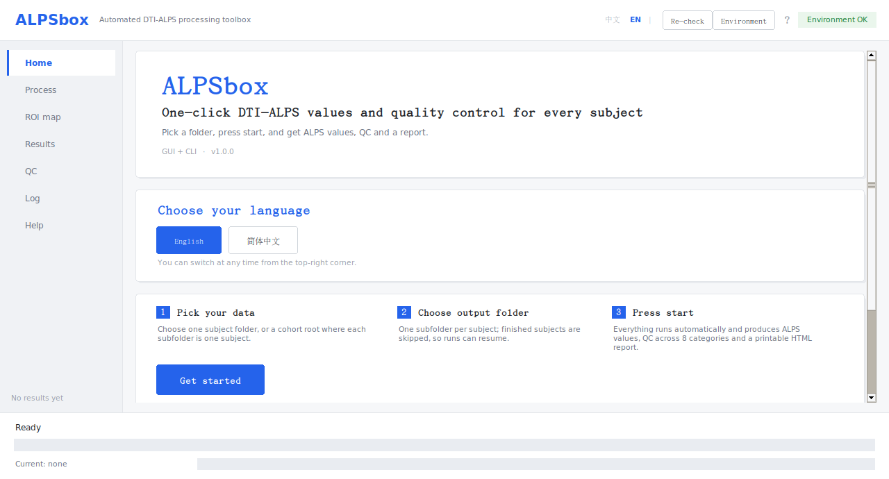
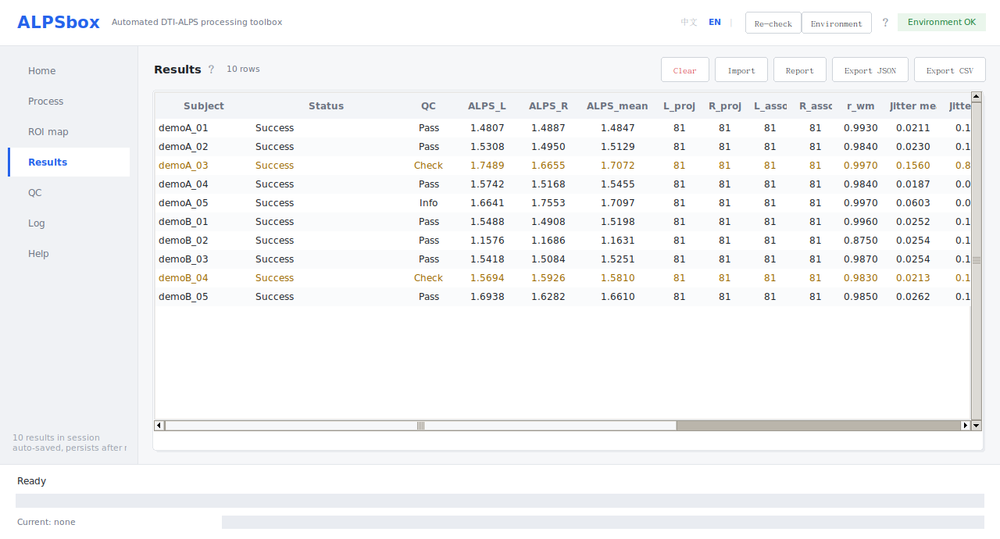
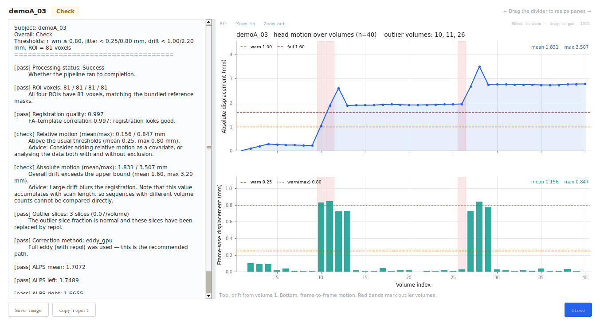

# ALPSbox

**一键算出每个被试的 DTI-ALPS 指数与质控。**

[**English**](README.md) | [**简体中文**](README.zh-CN.md)

[](https://doi.org/10.5281/zenodo.24137518)

ALPSbox 从扩散 MRI 计算沿血管周围间隙的扩散张量分析（DTI-ALPS）指数，
支持单个被试或整个队列，并补上做研究真正需要的东西：输入检查、可断点续跑的
批处理、8 类质控指标和可打印的 HTML 报告——底层调用标准的 FSL/MRtrix3 工具。

它是对 FSL 的一层薄而可复现的封装，不是新算法。默认值对齐 FSL 与开源参考实现
（`gbarisano/alps`，MIT），每条结果都会记录实际使用的处理口径，便于跨研究比较
与复现。

---

## 为什么用 ALPSbox？

参考实现 [gbarisano/alps](https://github.com/gbarisano/alps)（`alps.sh`，MIT）
很好地回答了一个问题：*这个被试的 ALPS 值是多少（在命令行里跑一次）？*
而一个研究还要问三个问题：*整个队列能不能一致地跑？*、*我知不知道哪些被试
不可靠？*、*每个数值究竟是怎么算出来的，能不能写进方法？* ALPSbox 就是围绕
这三点设计的：

1. **同一个测量**——与参数对齐后的参考实现做过验证（30 例完全外部被试
   r = 0.994）。
2. **默认可复现**——每个结果记录处理口径；批处理可续跑，除 eddy 本身外是
   确定性的。
3. **带质控**——八类质控指标，其中包括直接量化"该被试 ALPS 对配准有多敏感"的
   配准稳健性指标。
4. **队列级易用性**——GUI、一条命令的批处理、HTML 报告，以及供下游统计使用的
   CSV/JSON 导出。

由此产生的与参考脚本的差异：

| 任务 | ALPSbox | `alps.sh`（参考实现） |
|---|---|---|
| 带语言选择（中/英）的图形界面 | 有 | 无 |
| 一条命令跑完整队列，可中断续跑 | 有 | 无（一次一个被试，无续跑） |
| 自动发现并校验输入（DWI + bval/bvec + JSON） | 有 | 部分 |
| 8 类质控指标（通过/提示/需注意/不合格分档） | 有 | 无 |
| **配准稳健性质控（`--regqc`）** | **有** | 无 |
| 单文件 HTML 报告（可打印为 PDF，含判读与引用） | 有 | 无（只有 CSV） |
| 每条结果记录完整处理口径（`alps_result.json`） | 有 | 无 |
| 默认流程用 `vecreg` 做张量重定向 | 有 | 无（默认 `-f 1`，不重定向） |
| 可选 Gibbs 去振铃 / 去噪 / TOPUP | 有 | 有 |
| 中英文 GUI/CLI | 有 | 无 |
| 组统计 | 无——导出 CSV/JSON 后在下游做 | 无 |

参数对齐时两个工具的数值可比：在 30 例完全外部被试（OpenNeuro ds000030）上，
逐被试与参数对齐后的参考实现 r = 0.994（ICC 0.994，平均绝对差异 1.52%）。
默认设置确有差异，差异已写入文档；见 [docs/zh-CN/VALIDATION.md](docs/zh-CN/VALIDATION.md)
与 [docs/zh-CN/CITATIONS.md](docs/zh-CN/CITATIONS.md)。

---

## 界面截图

英文界面，使用合成示例队列（无真实被试数据）。







更多截图（处理页、质控表）见 [docs/assets/screenshots/](docs/assets/screenshots/)。

---

## 这个工具做什么、不做什么

**是**

- 一键管道：原始 DWI → ALPS 指数 + 质控 + 报告，单被试或整批
- 质控工具：8 类质控指标，包括参考实现没有的**配准稳健性**指标
- 报告生成器：单文件 HTML（可打印为 PDF）+ CSV/JSON 导出
- 图形界面 + 可脚本化命令行，中英双语；界面、处理日志、质控文字与
  HTML 报告都跟随所选语言

**不是**

- **不是**组统计工具。组间比较、前后测分析属于下游统计，
  请导出 CSV/JSON 后用 R / Python / SPSS 等完成。
- **不是**临床诊断工具。ALPS 目前没有公认诊断阈值。
- **不是**官方或标准实现——ALPS 没有这种标准。本仓库中「参考实现」的所指见
  [参考实现与引用](#参考实现与引用)。

---

## 快速开始

### 图形界面（推荐）

ALPSbox 在 Linux、macOS 上原生运行，Windows 通过 WSL2 运行；三者的 Python
包、命令行和 GUI 完全相同。请先装好 FSL 和 ALPSbox（见下文“安装”一节；
各系统的详细步骤见 [docs/zh-CN/INSTALL.md](docs/zh-CN/INSTALL.md)）。

| 系统 | 启动 GUI 的方式 |
|---|---|
| Windows | 双击 `ALPSbox-GUI.bat`（WSL2 + WSLg，FSL 装在 WSL 里） |
| Linux | 在 ALPSbox 目录运行 `bash run_gui.sh`，或 `alpsbox gui` |
| macOS | 在 ALPSbox 目录运行 `bash run_gui.sh`，或 `alpsbox gui` |

首页默认英文；如需中文，在首页选择 简体中文（仅本次会话）。然后选输入文件夹
（单个被试，或每个子文件夹一个被试的队列根目录）、选输出目录，先点
**① 先检查输入（必做）**：它只匹配文件、不处理图像，能提前发现缺文件以及
TOPUP/被试目录组织错误。**检查通过前「开始处理」不可用**；输入目录、模式或 TOPUP
设置一旦改变，需要重新检查。检查通过后再点 **② 开始处理**，查看 ALPS 值、质控
等级和 HTML 报告。

如果同一被试还有一套相位编码方向相反的 DWI（AP + PA），展开 **高级** 并勾选
**TOPUP**：单被试模式可选自动检测或手动指定第二套 DWI；批量模式会对每个被试
文件夹自动检测。输入格式见[输入要求](#输入要求)；每个结果文件都会记录 TOPUP
是否启用。

已完成的被试会自动跳过，中断后可以接着跑。macOS 没有 CUDA 版 `eddy`，
只能用 CPU（比 CUDA 机器慢约 5–10 倍）；Linux 装了 CUDA `eddy` 会自动使用。

### 命令行

```bash
# 环境自检
alpsbox check

# 只检查输入（不做处理）
alpsbox dryrun /path/to/cohort --out ./results

# 单个被试
alpsbox run /path/to/sub_001 --out ./results/sub_001

# 批量（每个子文件夹一个被试）
alpsbox batch /path/to/cohort --out ./results --workers 1

# TOPUP（双相位编码）：单被试显式指定第二套，或队列按被试自动检测
alpsbox run /path/to/sub_001 --out ./results/sub_001 \
    --dwi2 AP.nii.gz --bval2 AP.bval --bvec2 AP.bvec --json2 AP.json
alpsbox batch /path/to/cohort --out ./results --workers 1 --topup-auto

# 对已有结果生成 HTML 报告
alpsbox report /path/to/results
```

默认输出语言是英文。给任意子命令加 `--lang zh_CN`（或 `--lang en`）可切换
本次运行的语言；GUI 首页可选择本次会话的语言。

常见报错见 [docs/zh-CN/FAQ.md](docs/zh-CN/FAQ.md)，
各平台安装步骤见 [docs/zh-CN/INSTALL.md](docs/zh-CN/INSTALL.md)。

---

## 你会得到什么

| 输出 | 内容 |
|---|---|
| ALPS 值 | `alps_L`、`alps_R`、`alps_mean`，以及公式用到的 8 个扩散率分量 |
| 质控（8 类 + 处理状态） | 配准质量 `r_wm`、帧间运动、绝对漂移、离群切片、校正方法、ROI 体素数、ALPS 合理性、**配准稳健性 `regqc`**；处理是否完成单独报告 |
| 等级 | 通过 / 提示 / 需注意 / 不合格，均附解释 |
| 报告 | 单文件 HTML（可打印为 PDF）：数值、**逐项质控检查与完整解释、当前质控阈值、自动生成的头动/配准-ROI 质控图**、判读、处理口径与引用；语言跟随界面。GUI 中处理完成后会自动写入每个被试的目录 |
| 表格 | `alps_summary.csv`（每被试一行）、每个被试的 `alps_result.json`、`qc_report.txt` |
| 可复现信息 | 每个 `alps_result.json` 记录实际处理口径：`bet_f`、`reg_cost`、`template`、`unring`、`denoise`、eddy 方法、TOPUP 状态与配置，以及全部质控指标 |

配准稳健性质控（`--regqc`）会对配准矩阵做 12 次微小扰动，量化 ALPS 的变化幅度。
我们的验证中这个不确定度（6–12%）远大于 eddy 本身的非确定性（2.04%，最大
4.11%），所以 ALPS 数值必须连同配准细节一起报告。全部实验参数见
[docs/zh-CN/VALIDATION.md](docs/zh-CN/VALIDATION.md)。

### 输出文件

- `alps_summary.csv`——每被试一行；列包括 `subject`、`ok`、`alps_L/R/mean`、
  各分量、`r_wm`、头动指标、`n_outlier`、`regqc_*`、`bet_f`、`reg_cost`、
  `template`、eddy `method`，以及 TOPUP 状态 `topup` 与配置 `topup_config`。
- `<被试>/alps_result.json`——单个被试的上述数值 + 处理口径；队列重跑时直接复用。
- `<被试>/qc_report.txt`——人类可读的逐被试质控摘要。
- `<被试>/report.html`——单文件 HTML 报告。GUI 中每个被试处理完成后会自动
  生成，不需要再点“生成报告”。

想先看报告长什么样，可以直接打开用示例队列（无真实被试）生成的样例：
[docs/example_report.html](docs/example_report.html)。

---

## 输入要求

每个被试文件夹需要一套同名的扩散数据：

```
sub_001/
  DTI1/xxx.nii.gz     # 4D DWI，第一体积为 b0
  DTI1/xxx.bval
  DTI1/xxx.bvec
  DTI1/xxx.json       # 推荐：PhaseEncodingDirection + TotalReadoutTime
```

假定单壳 DTI（b = 1000），以便与已发表的 ALPS 数值比较。没有 `.json` 时会回落到
`eddy_correct`（有已知偏差），这类被试会在质控列标出，不要与完整 eddy 处理的被试
在下游统计中混用。

### 可选：TOPUP 双相位编码畸变校正

提供一套**相位编码方向相反**的第二套 DWI（例如 AP + PA）即可在 eddy 之前启用
TOPUP 磁化率畸变校正。两套数据必须来自同一被试，各自使用常规的四件套
（NIfTI + 同名 `.bval` + `.bvec` + BIDS `.json`）；每套第一个 volume 为 b0，
两套 `.json` 都要有 `PhaseEncodingDirection`（同一轴、一正一负）与
`TotalReadoutTime`。DICOM 需先用 dcm2niix 转换，和主数据一样。两套方向相同的
数据不会被启用。

```text
sub_001/
  AP/xxx.nii.gz  xxx.bval  xxx.bvec  xxx.json    # 例如 PhaseEncodingDirection = j-
  PA/xxx.nii.gz  xxx.bval  xxx.bvec  xxx.json    # 例如 PhaseEncodingDirection = j
```

- **命令行，单被试：** `--dwi2/--bval2/--bvec2/--json2`（四个都要给）。
- **命令行，批量：** `--topup-auto` 会检查每个被试文件夹并自动配对反向 PE
  数据；没有第二套也没关系，按单相位编码继续。
- **参数：** 默认自动查找 FSL 的 `b02b0.cnf`；可用
  `--topup-config /path/to/b02b0.cnf` 指定其它配置。
- **GUI：** **高级 → TOPUP**（自动检测或手动指定第二套 DWI；批量模式按被试
  自动检测）。单被试的“自动检测”先在被试文件夹内查找，找不到时会检查同一上级
  目录中的少量相邻文件夹（名称像同一序列的 AP/PA 变体时；这是 AP/PA 分文件夹
  导出的常见结构），日志会注明使用了哪个文件夹，请确认属于同一被试。也可以直接
  选择包含两套数据的上级目录。
- **可复现信息：** `alps_result.json` / `alps_summary.csv` 增加 `topup` 状态
  （`on`、`off`、`skipped: 原因`、`failed`）与配置名；HTML 报告的处理口径和
  质控报告都会列出 TOPUP 使用情况。

#### 批量目录与安全检查（重要）

批量模式下**根目录的每个直接子文件夹 = 一个被试**，一个被试只对应一个结果文件
夹。被试文件夹里的 AP/PA 可以按下面任一种方式组织，都会被正确配对并只处理一次：

```text
队列根目录/
  sub-001/
    AP/  dwi.nii.gz dwi.bval dwi.bvec dwi.json   # 反向相位编码
    PA/  dwi.nii.gz dwi.bval dwi.bvec dwi.json   # 反向相位编码
  sub-002/                                        # 或两套数据并排放在同一层
    dwi_AP.nii.gz ... dwi_PA.nii.gz ...
```

开始处理之前，批量预检会检查目录结构以及每个 TOPUP 配对是否可靠：

- **AP/PA 被拆成两个“被试”文件夹会被阻止**：如果两个被试文件夹去掉方向标记后
  名称相近、且相位编码方向相反，程序会在处理开始前停止，列出这两个文件夹，并把
  记录写入输出目录的 `preflight_report.txt`。请把两套数据放进同一个被试文件夹
  （`AP/`、`PA/` 子文件夹，或两套并排）后重跑。
- **配对一致性检查**：两套数据必须具有相同的 bval 方案、bvec 数量，以及双方
  JSON 都提供的采集元数据（TE、TR、层厚、场强、厂商、去掉方向标记后的协议名），
  并检查图像几何（尺寸、体素大小、affine；有 nibabel 时）。如果找到的反向 PE
  数据明显属于另一套采集/另一个被试，程序会明确报错并阻止，而不是悄悄使用或
  悄悄跳过。
- **记录**：被试列表、PE 方向、TOPUP 状态和全部阻止原因会在处理前写入
  `<输出目录>/preflight_report.txt`，同时显示在 GUI/CLI 日志里。
- **局限**：dcm2niix 生成的 BIDS json 通常不含患者标识，如果两个被试使用完全
  相同的协议、矩阵、几何和扩散方案，仅凭图像无法自动区分。上面的检查能挡住
  明显不一致/混杂的数据，但正确的数据组织仍由使用者负责；请保留源 DICOM 的
  患者信息并核对被试文件夹。

---

## 安装

**系统要求**

ALPSbox 在 Linux、macOS（含 Apple Silicon）上原生运行，Windows 通过 WSL2
运行；Windows 原生不支持，因为 FSL 没有 Windows 版本。

| 组件 | 必需 | 说明 |
|---|---|---|
| Linux / macOS / WSL2 | 是 | Linux、macOS 原生运行；Windows 走 WSL2（不支持原生 Windows） |
| Python 3.10+ | 是 | `pip install -e .` 会安装 NumPy、nibabel、Pillow、matplotlib |
| FSL 6.0.3+ | 是 | 需要 `eddy`、`bet`、`dtifit`、`flirt`、`vecreg`、`fslroi`、`fslmaths`、`fslstats`、`fslval`、`fslcc`；CUDA `eddy` 可选 |
| MRtrix3 | 推荐 | `mrdegibbs`（去 Gibbs 振铃）；缺失时跳过并给出警告 |
| dcm2niix | 可选 | 只有 DICOM → NIfTI 转换时需要 |
| tkinter | GUI 需要 | python.org 的 Windows/macOS 安装包自带；Homebrew 的 Python 需另装匹配的 `python-tk`；Linux `sudo apt install python3-tk` |
| X / WSLg | GUI 需要 | Windows 11 自带 WSLg |

ALPSbox **不打包** FSL 与 MRtrix3（FSL 许可为非商业用途且禁止再分发）。
请先装好它们，再安装 ALPSbox：

```bash
git clone https://github.com/czf-chen/alpsbox.git
cd alpsbox
pip install -e .          # 或：pip install -r requirements.txt
alpsbox check             # 检查 FSL / MRtrix3 / dcm2niix
```

各平台详细步骤见 [docs/zh-CN/INSTALL.md](docs/zh-CN/INSTALL.md)。

**运行时间**：eddy 约占八成时间。66 体积的被试在 CPU `eddy` 下约 10–15 分钟，
CUDA 版会快数倍；批处理默认顺序执行（`--workers 1`），因为瓶颈通常是 GPU 显存。

---

## 我们如何验证

按问题顺序讲三个问题。

1. **是同一个测量吗？** 确定性环节与参数对齐后的参考实现一致（去振铃 DWI、
   脑掩膜、ROI 掩膜/体素数、公式）。在 30 例完全外部健康对照（OpenNeuro
   ds000030）上，逐被试与参考实现的一致性为 **r = 0.994**（ICC 0.994，
   平均绝对差异 1.52%，全部 ≤ 5%）；eddy 自身重复运行噪声为 2.04%（最大
   4.11%），即一致性已达到噪声下限。这说明计算的是既有 DTI-ALPS 指数，
   不是新算法。
2. **什么会改变 ALPS？** 按实际重要性排序：配准路径（配对 10 例，
   |ΔALPS| 中位 **16%**）> 脑提取阈值 `bet -f` 0.5 vs 0.3（平均 **11.2%**，
   最大 43.9%）> 配准矩阵小误差（±0.5° / ±0.5 mm 扰动下 6.6–12%）>
   配准代价函数（平均 5.9%，最大 14.1%）> TOPUP（−4.43%，n = 1）>
   eddy 重复运行噪声（2.04%）。因此工具在每个结果文件里记录完整处理口径，
   并提供配准稳健性质控（`--regqc`）。
3. **质控有用吗？** 有：配准质量低能预测参数敏感度（外部 15 例：低 `r_wm`
   组 ALPS 中位变化 5.8%，高 `r_wm` 组 1.3%；r = −0.69，控制头动后偏相关
   −0.77）。质控标出的是"使用前需要复核"的被试。

全部队列、协议与参数见 [docs/zh-CN/VALIDATION.md](docs/zh-CN/VALIDATION.md)。
验证仅覆盖单中心 3T、单壳数据；未经重新验证时 ALPS 数值不可跨协议比较。

---

## 参考实现与引用

**ALPS 没有官方或标准认证实现。** 本仓库提到的「参考实现」（旧文档中的
「官方 alps.sh」）**一律专指**下面这个开源项目；ALPSbox **不打包、不修改**它，
验证中使用的是参数对齐后的设置。

ALPS 方法原始文献：

[1] Taoka T, Masutani Y, Kawai H, Nakane T, Matsuoka K, Yasuno F, Kishimoto T, Naganawa S.
Evaluation of glymphatic system activity with the diffusion MR technique:
diffusion tensor image analysis along the perivascular space (DTI-ALPS) in
Alzheimer's disease cases. *Japanese Journal of Radiology*.
2017;35(4):172-178. doi:10.1007/s11604-017-0617-z

我们对比的参考实现：

[2] Barisano G. *alps: Bash script to compute DTI-ALPS (alps.sh)*.
GitHub repository. https://github.com/gbarisano/alps.
Commit e6f58e7c1b882a799b613e91fe15bab940dc4cd3 (2025-09-12).
Accessed 2026-11-11. MIT License.

该仓库要求的配套论文：

[3] Liu X, Barisano G, et al. Cross-vendor test-retest validation of diffusion
tensor image analysis along the perivascular space (DTI-ALPS) for evaluating
glymphatic system function. *Aging and Disease*.
2024;15(4):1885-1898. doi:10.14336/AD.2023.0321-2

随包 ROI 掩膜复制自 [2] 的 `ROIs_JHU_ALPS/` 目录（MIT License，
Copyright (c) 2023 Giuseppe Barisano），来源与 sha256 校验值见
[alpsbox/data/ROIs_JHU_ALPS/PROVENANCE.md](alpsbox/data/ROIs_JHU_ALPS/PROVENANCE.md)。

> 默认设置不同：参考实现默认用 `flirt/applywarp`（`-f 1`，不做张量重定向）、
> 去噪 + 去振铃、`corratio` 代价函数；ALPSbox 默认用 `vecreg` 重定向、
> 只去振铃、`normmi`。因此任何"与参考实现的差异"都必须写明所用设置。
> 完整引用（含每一步处理与第三方工具）见
> [docs/zh-CN/CITATIONS.md](docs/zh-CN/CITATIONS.md)。

### 引用 ALPSbox

归档版本（Zenodo DOI）：[10.5281/zenodo.24137518](https://doi.org/10.5281/zenodo.24137518)。

机器可读元数据见 [CITATION.cff](CITATION.cff)（GitHub 会显示
"Cite this repository"）。论文中请同时引用本软件、方法原始文献与参考实现
（软件 + 配套论文）；具体格式见 [docs/zh-CN/CITATIONS.md](docs/zh-CN/CITATIONS.md) §1。

---

## 仓库结构

```
alpsbox/
├── alpsbox/            # Python 包（处理管道、质控、GUI、CLI、报告）
│   ├── data/           # 随包 ROI 掩膜 + 来源说明
│   └── ui/             # Tk 组件、主题、会话
├── docs/               # 英文文档；zh-CN/ 为中文镜像
├── examples/           # 试 GUI 用的合成示例队列
├── tests/              # 不需要 FSL 的测试
├── scripts/            # 发布辅助：填写仓库 URL / Zenodo DOI
├── .github/workflows/  # CI：编译、发布完整性审计、CLI 冒烟测试
├── ALPSbox-GUI.bat     # Windows 启动脚本（双击）
├── run_gui.sh          # WSL/Linux/macOS 启动脚本
├── CITATION.cff        # GitHub「Cite this repository」
├── CHANGELOG.md        # 公开发布日志
├── CONTRIBUTING.md     # 如何报告问题与贡献
├── .zenodo.json        # GitHub release 的 Zenodo 元数据
├── requirements.txt    # Python 依赖
├── README.md           # 英文（默认）
└── README.zh-CN.md     # 中文
```

---

## 参与贡献

欢迎提交 issue、代码以及文案/翻译修正，详见 [CONTRIBUTING.md](CONTRIBUTING.md)。
CI 会在 Python 3.10–3.12 上跑字节编译、发布完整性/引用审计与 CLI 冒烟测试；
需要 FSL 的处理流程测试在本地运行。

---

## 隐私与许可

- 全部处理在本机完成，不上传任何数据。
- 代码：MIT，见 [LICENSE](LICENSE)。
- 随包 ROI 掩膜：MIT，Copyright (c) 2023 Giuseppe Barisano，见
  [LICENSE_Barisano_alps.txt](LICENSE_Barisano_alps.txt)。
- FSL 与 MRtrix3 不在本包内，需按各自许可以自行安装。

## 已知限制

- 假定单壳 DTI（b = 1000）；不同 b 值或扫描协议下 ALPS 不可直接比较。
- 质控阈值是按 1.5 mm / 64 方向 3T 数据设定的实践性默认值，换协议需按本队列调整。
- 不做临床诊断、不做组统计、不做跨站点 harmonisation。
